# Variety Groceries — complete role-based system manual (source edition)

**Reviewed 20 November 2026** against actual Next.js screen routes and separately gated backend authorities.

> **Release warning:** This is a source-level training and UAT document, not authorization to take payment, move stock, approve refunds, collect COD, send SMS, use AI to modify records, or replace the staging portal. Preview and gated screens are not certified live. All diagrams are **annotated conceptual maps**, not screenshots.

## Open, navigate and download

- The in-app manual is available at **/manual** from the storefront Help navigation, administrator sidebar and authenticated cashier portal; the legacy rider portal links to **/rider/guide**.
- Screen guides include actual application route, purpose, the next user action, an independent verification checkpoint and an annotated screen map.
- Search, chapter navigation, next/previous, workflow selection and a role-scoped PDF print command are available. The **Download manual** control generates a single offline HTML document with an internal table of contents and every guide chapter relevant to the current authenticated role. **Print / Save PDF** opens that complete edition for browser printing.
- Real roles come from the authenticated **/auth/me** response. Guests receive only customer/shared instructions (legacy rider demo route only rider/shared). The role selector is shown to verified administrators only. Admin sees all guides; a documented task never grants API permissions.
- The standalone HTML edition is created only after a user-initiated download; unauthenticated visitors receive customer-safe (or rider-demo-safe) chapters only. Do not serve an unfiltered admin PDF from a public route. No credentials, provider secrets, customer records or real account data appear in the manual.

## Role visibility

| Verified role | Visible screen guides | Workflow diagrams | Notes |
|---|---:|---:|---|
| Administrator — all roles | 81 | 11 | All role views; preview as each role without changing backend permissions. |
| Customer | 31 | 3 | Only role-specific and common guidance; actual API grants remain server-enforced. |
| Inventory manager | 14 | 1 | Only role-specific and common guidance; actual API grants remain server-enforced. |
| Cashier | 9 | 2 | Only role-specific and common guidance; actual API grants remain server-enforced. |
| Rider | 13 | 1 | Only role-specific and common guidance; actual API grants remain server-enforced. |

## Authority and specialist role mapping

**Authenticated API role set (current):** administrator, inventory manager, cashier, rider and customer. Administrators see the full guide, currently 79 main-derived source pages plus two separately marked draft POS pages from PR #175; those two are not deployed. Other authenticated roles see the screens applicable to their role plus shared guidance. A manual chapter never grants API access.

**Design/demo specialization (not a live role grant):** owner/admin, operations manager, inventory officer, cashier, picker/packer, dispatcher, finance/refund reviewer and rider exist as richer design-time/demo menu roles. Their distinct production server grants and branch scopes are separate UAT/implementation work. In particular, the staff demo selector is **not** a production impersonation or authorization mechanism.

**Release decision:** Test actual server-granted account role and resource scope for each persona, including direct URL denial, staff revocation, branch reassignment, cashier cash limits and independent refund approvals. Do not infer backend authority from a visual menu.

## Overall business process

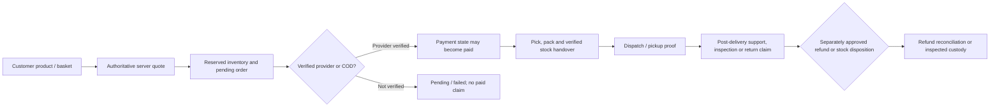

## Role-specific workflows

### 1. Customer shopping and verified payment

**Primary audience:** customer. From selecting groceries to an authorized order; checkout is not final until the provider has been independently verified.

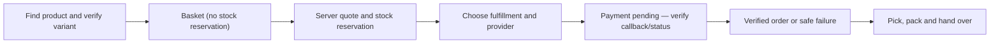

**Critical control:** Never mark an order paid from browser redirect, SMS, HTTP 200 or a self-reported screen alone.

**Next step:** Use My orders or Track order; failed or pending payment must remain explicitly unresolved.

### 2. Stock-safe picking and delivery

**Primary audience:** admin. Fulfilment uses the original eligible order and stock-reservation evidence; dispatch and delivery are separate.

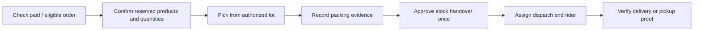

**Critical control:** No duplicate stock decrement: handover must reference the approved depletion record.

**Next step:** If short or damaged, follow the authorized substitution/exception flow; never adjust stock silently.

### 3. Receiving, inventory and audited adjustments

**Primary audience:** inventory. Physical stock movement is tied to verified item, lot, expiry, location and a durable evidence trail.

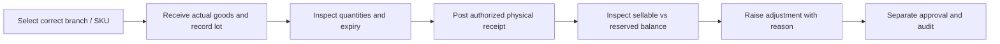

**Critical control:** A purchase order, spreadsheet edit or draft adjustment is not proof of physical receipt.

**Next step:** Exclude quarantined, expired, reserved and safety stock from available-to-sell.

### 4. Counter cash sale: gated UAT workflow

**Primary audience:** admin. Separate, currently gated physical cash path. Do not confuse the cashier read-only workspace with a live sales terminal.

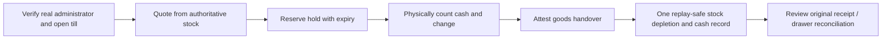

**Critical control:** Only authorized real-cash operations behind explicit backend flags; the read-only cashier workspace cannot execute these actions.

**Next step:** Cash receipt is not a VAT invoice, MoMo confirmation, bank reconciliation or financial settlement.

### 5. Cash-drawer shift reconciliation

**Primary audience:** admin. Review the source ledger and distinguish a physical cash count difference from an internal accounting mismatch.

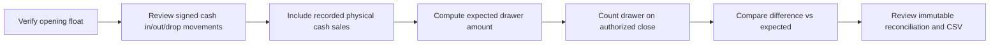

**Critical control:** An internally consistent ledger may still have a physical cash shortage or overage.

**Next step:** Escalate differences with cash evidence; never reinterpret them as a successful electronic payment.

### 6. Rider COD declaration and independent review

**Primary audience:** rider. Rider-collected cash is separate from order delivery and from merchant remittance.

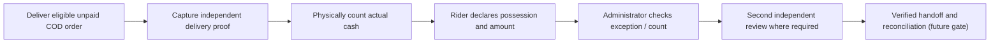

**Critical control:** Rider declaration is not a bank deposit, supervisor receipt or fulfilled remittance obligation.

**Next step:** Keep a clear exception record for mismatched amounts; do not mark the payment electronically settled.

### 7. Customer return request and inspected goods custody

**Primary audience:** customer. A customer claim, physical receipt, inspection, resale decision and refund are distinct approvals.

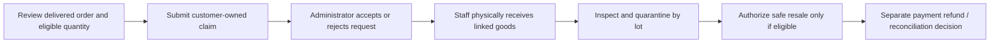

**Critical control:** An accepted request or a delivery return must never automatically restock goods or release money.

**Next step:** Food, expired, damaged and unverified lots remain non-saleable.

### 8. Publish verified catalogue and storefront content

**Primary audience:** admin. Public content must be based on reviewed source material, not generated assurances.

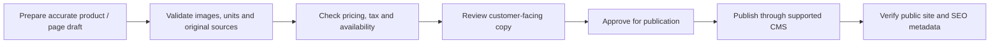

**Critical control:** Do not publish invented nutrition facts, availability, provider claims or return terms.

**Next step:** Recheck live appearance on mobile after approval and publication.

### 9. Dispatcher and rider operational lifecycle

**Primary audience:** admin. Shipping and fulfilment are evidence-based steps, not predictions of location or cash.

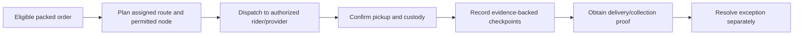

**Critical control:** An automated stage change must not fabricate a GPS point, ETA, pickup, delivery or COD payment.

**Next step:** Use exception screens for failed, late, returned or uncontactable deliveries.

### 10. Staff onboarding and access revocation

**Primary audience:** admin. Each role requires the correct server-owned permission and branch; a menu being visible grants nothing by itself.

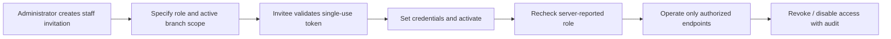

**Critical control:** Demo identities, old invitation links and browser role selectors must not become authorization.

**Next step:** Review audit trails and branch permissions after any staff change.

### 11. Customer self-service and support

**Primary audience:** customer. Customer account views are scoped to their own identity; support must verify ownership before accessing records.

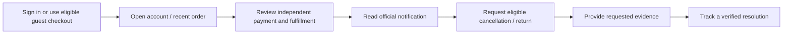

**Critical control:** Never share an account password, reset token or provider secret with support agents.

**Next step:** Escalate uncertain status rather than telling the customer money has moved.

## Screen-by-screen reference

**Scope:** 79 canonical main-derived application routes and 2 additional administrator-only draft POS routes from unmerged PR #175. The two draft routes are NOT DEPLOYED, are not present in this source checkout and must not be marked tested until the approved POS release is deployed.

### 01. Storefront home

**Route:** `/` · **Audience:** customer · **Status:** Prototype or preview — verify backend authority

- **Purpose:** Browse featured groceries, offers, categories and shop entry points.
- **Steps:** Locate the navigation and screen; Choose a department or search for a product.
- **Verify:** Product imagery, availability and offers require published catalogue review.
- **Screen figure:** Product browsing cards (catalogue). The visual below is illustrative, not a screenshot. During UAT, check actual controls against the corresponding authenticated screen.

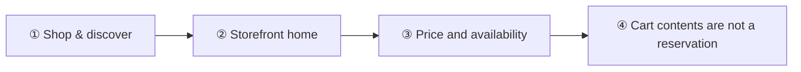

### 02. All groceries

**Route:** `/shop` · **Audience:** customer · **Status:** Prototype or preview — verify backend authority

- **Purpose:** Browse and filter the grocery catalogue.
- **Steps:** Locate the navigation and screen; Search, choose a category, inspect an item and its unit.
- **Verify:** A displayed item is not a guaranteed reservation.
- **Screen figure:** Product browsing cards (catalogue). The visual below is illustrative, not a screenshot. During UAT, check actual controls against the corresponding authenticated screen.

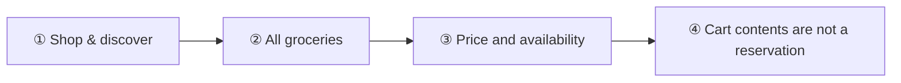

### 03. Categories

**Route:** `/categories` · **Audience:** customer · **Status:** Prototype or preview — verify backend authority

- **Purpose:** Browse grocery departments.
- **Steps:** Locate the navigation and screen; Open a category tile to view its product list.
- **Verify:** Only verified, published products should be offered.
- **Screen figure:** Product browsing cards (catalogue). The visual below is illustrative, not a screenshot. During UAT, check actual controls against the corresponding authenticated screen.

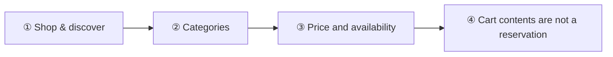

### 04. Category products

**Route:** `/categories/[slug]` · **Audience:** customer · **Status:** Prototype or preview — verify backend authority

- **Purpose:** View products in one department.
- **Steps:** Locate the navigation and screen; Review pack sizes and product cards; open product details.
- **Verify:** Stock must be checked again at checkout.
- **Screen figure:** Product browsing cards (catalogue). The visual below is illustrative, not a screenshot. During UAT, check actual controls against the corresponding authenticated screen.

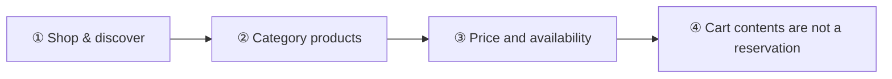

### 05. Product details

**Route:** `/products/[slug]` · **Audience:** customer · **Status:** Prototype or preview — verify backend authority

- **Purpose:** Review a product, variants, image, quantity and price.
- **Steps:** Locate the navigation and screen; Choose a variant and add a suitable quantity to the basket.
- **Verify:** Product descriptions and allergen details must come from verified sources.
- **Screen figure:** Product browsing cards (catalogue). The visual below is illustrative, not a screenshot. During UAT, check actual controls against the corresponding authenticated screen.

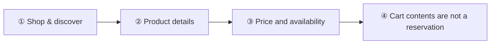

### 06. Shopping basket

**Route:** `/cart` · **Audience:** customer · **Status:** Prototype or preview — verify backend authority

- **Purpose:** Review selected products before checkout.
- **Steps:** Locate the navigation and screen; Adjust quantities, remove items and proceed to checkout.
- **Verify:** Basket contents are not reserved stock.
- **Screen figure:** Customer checkout sequence (checkout). The visual below is illustrative, not a screenshot. During UAT, check actual controls against the corresponding authenticated screen.

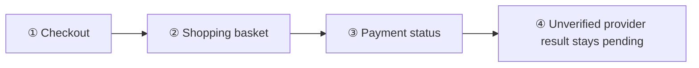

### 07. Checkout

**Route:** `/checkout` · **Audience:** customer · **Status:** UAT / controlled feature gate

- **Purpose:** Choose delivery or pickup, confirm the authoritative quote and initiate payment.
- **Steps:** Locate the navigation and screen; Confirm contact, address/collection point and method; submit once.
- **Verify:** Never treat a redirect or provider HTTP 200 as verified settlement.
- **Screen figure:** Customer checkout sequence (checkout). The visual below is illustrative, not a screenshot. During UAT, check actual controls against the corresponding authenticated screen.

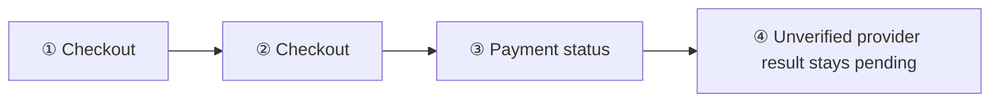

### 08. Payment provider return

**Route:** `/checkout/payment-return` · **Audience:** customer · **Status:** UAT / controlled feature gate

- **Purpose:** Display the provider-return checkpoint after hosted checkout.
- **Steps:** Locate the navigation and screen; Follow the status link to verify the server's latest recorded outcome.
- **Verify:** A browser return is not proof that money was captured.
- **Screen figure:** Customer checkout sequence (checkout). The visual below is illustrative, not a screenshot. During UAT, check actual controls against the corresponding authenticated screen.

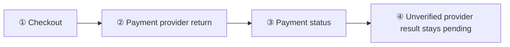

### 09. Checkout status

**Route:** `/checkout/status/[id]` · **Audience:** customer · **Status:** UAT / controlled feature gate

- **Purpose:** Track a specific checkout/order verification state.
- **Steps:** Locate the navigation and screen; Refresh status and follow the verified order reference.
- **Verify:** An unresolved provider state must not be labelled paid.
- **Screen figure:** Customer checkout sequence (checkout). The visual below is illustrative, not a screenshot. During UAT, check actual controls against the corresponding authenticated screen.

```mermaid
flowchart LR
  N["① Checkout"] --> V["② Checkout status"]
  V --> A["③ Payment status"]
  A --> C["④ Unverified provider result stays pending"]
```

### 10. Track an order

**Route:** `/track` · **Audience:** customer · **Status:** Prototype or preview — verify backend authority

- **Purpose:** Track a legitimate order using its reference and verification proof.
- **Steps:** Locate the navigation and screen; Enter required verification details and inspect milestones.
- **Verify:** Location and ETA must be supported by real delivery evidence.
- **Screen figure:** Evidence timeline (timeline). The visual below is illustrative, not a screenshot. During UAT, check actual controls against the corresponding authenticated screen.

```mermaid
flowchart LR
  N["① Orders & delivery"] --> V["② Track an order"]
  V --> A["③ Current status"]
  A --> C["④ Every status transition must be supported by source evidence"]
```

### 11. Delivery options

**Route:** `/delivery` · **Audience:** customer · **Status:** Prototype or preview — verify backend authority

- **Purpose:** Understand service areas, fulfilment and pickup options.
- **Steps:** Locate the navigation and screen; Review zones and any displayed fees or pickup instructions.
- **Verify:** Actual coverage and operating hours need launch validation.
- **Screen figure:** Guidance and assistance (guide). The visual below is illustrative, not a screenshot. During UAT, check actual controls against the corresponding authenticated screen.

```mermaid
flowchart LR
  N["① Orders & delivery"] --> V["② Delivery options"]
  V --> A["③ Follow relevant action"]
  A --> C["④ Published guidance must match current approved business rules"]
```

### 12. Delivery report

**Route:** `/delivery-report` · **Audience:** customer · **Status:** Prototype or preview — verify backend authority

- **Purpose:** View delivery-related information exposed in the storefront.
- **Steps:** Locate the navigation and screen; Inspect available delivery breakdowns.
- **Verify:** Report content is not a verified rider cash receipt.
- **Screen figure:** Searchable operational records (ledger). The visual below is illustrative, not a screenshot. During UAT, check actual controls against the corresponding authenticated screen.

```mermaid
flowchart LR
  N["① Orders & delivery"] --> V["② Delivery report"]
  V --> A["③ Select one record"]
  A --> C["④ List visibility does not independently authorize mutations"]
```

### 13. Customer sign in

**Route:** `/account/login` · **Audience:** customer · **Status:** Implemented screen (acceptance still required)

- **Purpose:** Access a customer account using registered credentials.
- **Steps:** Locate the navigation and screen; Sign in with phone or email and password.
- **Verify:** Never share one-time codes or passwords with support agents.
- **Screen figure:** Validated entry or edit (form). The visual below is illustrative, not a screenshot. During UAT, check actual controls against the corresponding authenticated screen.

```mermaid
flowchart LR
  N["① Account & support"] --> V["② Customer sign in"]
  V --> A["③ Validate input"]
  A --> C["④ The backend independently enforces authorization and field validation"]
```

### 14. Create an account

**Route:** `/account/signup` · **Audience:** customer · **Status:** Implemented screen (acceptance still required)

- **Purpose:** Register a customer account.
- **Steps:** Locate the navigation and screen; Provide real contact details and a strong password.
- **Verify:** Registration is separate from confirming a successful purchase.
- **Screen figure:** Validated entry or edit (form). The visual below is illustrative, not a screenshot. During UAT, check actual controls against the corresponding authenticated screen.

```mermaid
flowchart LR
  N["① Account & support"] --> V["② Create an account"]
  V --> A["③ Validate input"]
  A --> C["④ The backend independently enforces authorization and field validation"]
```

### 15. My account

**Route:** `/account` · **Audience:** customer · **Status:** Implemented screen (acceptance still required)

- **Purpose:** See account summary, recent orders and shortcuts.
- **Steps:** Locate the navigation and screen; Open recent orders, addresses and profile.
- **Verify:** Information is scoped to the signed-in customer.
- **Screen figure:** Overview and KPI panels (dashboard). The visual below is illustrative, not a screenshot. During UAT, check actual controls against the corresponding authenticated screen.

```mermaid
flowchart LR
  N["① Account & support"] --> V["② My account"]
  V --> A["③ Action queue"]
  A --> C["④ A summary is not a substitute for its source ledger"]
```

### 16. My profile

**Route:** `/account/profile` · **Audience:** customer · **Status:** Implemented screen (acceptance still required)

- **Purpose:** Review and update customer contact information.
- **Steps:** Locate the navigation and screen; Edit supported fields and save; confirm changes.
- **Verify:** Correct phone and address details are essential for delivery.
- **Screen figure:** Validated entry or edit (form). The visual below is illustrative, not a screenshot. During UAT, check actual controls against the corresponding authenticated screen.

```mermaid
flowchart LR
  N["① Account & support"] --> V["② My profile"]
  V --> A["③ Validate input"]
  A --> C["④ The backend independently enforces authorization and field validation"]
```

### 17. Saved addresses

**Route:** `/account/addresses` · **Audience:** customer · **Status:** Prototype or preview — verify backend authority

- **Purpose:** Manage saved delivery destinations.
- **Steps:** Locate the navigation and screen; Add or edit an address and check landmarks before checkout.
- **Verify:** Saving an address does not book a delivery slot.
- **Screen figure:** Validated entry or edit (form). The visual below is illustrative, not a screenshot. During UAT, check actual controls against the corresponding authenticated screen.

```mermaid
flowchart LR
  N["① Account & support"] --> V["② Saved addresses"]
  V --> A["③ Validate input"]
  A --> C["④ The backend independently enforces authorization and field validation"]
```

### 18. Saved lists

**Route:** `/account/lists` · **Audience:** customer · **Status:** Prototype or preview — verify backend authority

- **Purpose:** Keep preferred shopping items for later.
- **Steps:** Locate the navigation and screen; Review and update favourite or repeat-shopping lists.
- **Verify:** Reordering still requires fresh stock and price verification.
- **Screen figure:** Searchable operational records (ledger). The visual below is illustrative, not a screenshot. During UAT, check actual controls against the corresponding authenticated screen.

```mermaid
flowchart LR
  N["① Account & support"] --> V["② Saved lists"]
  V --> A["③ Select one record"]
  A --> C["④ List visibility does not independently authorize mutations"]
```

### 19. Notifications

**Route:** `/account/notifications` · **Audience:** customer · **Status:** UAT / controlled feature gate

- **Purpose:** Read customer-owned in-app updates.
- **Steps:** Locate the navigation and screen; Review unread items and open linked orders.
- **Verify:** In-app notices do not prove that an SMS/email was delivered.
- **Screen figure:** Searchable operational records (ledger). The visual below is illustrative, not a screenshot. During UAT, check actual controls against the corresponding authenticated screen.

```mermaid
flowchart LR
  N["① Account & support"] --> V["② Notifications"]
  V --> A["③ Select one record"]
  A --> C["④ List visibility does not independently authorize mutations"]
```

### 20. My orders

**Route:** `/account/orders` · **Audience:** customer · **Status:** Implemented screen (acceptance still required)

- **Purpose:** Review customer-owned order history and statuses.
- **Steps:** Locate the navigation and screen; Open an order for the current recorded payment and fulfilment state.
- **Verify:** Payment, packing and delivery are independent statuses.
- **Screen figure:** Searchable operational records (ledger). The visual below is illustrative, not a screenshot. During UAT, check actual controls against the corresponding authenticated screen.

```mermaid
flowchart LR
  N["① Orders & delivery"] --> V["② My orders"]
  V --> A["③ Select one record"]
  A --> C["④ List visibility does not independently authorize mutations"]
```

### 21. Order details

**Route:** `/account/orders/[id]` · **Audience:** customer · **Status:** Implemented screen (acceptance still required)

- **Purpose:** Inspect the lines, prices and progress of a particular order.
- **Steps:** Locate the navigation and screen; Check payment verification, fulfilment and eligible next actions.
- **Verify:** Cancellation and return eligibility are controlled by the backend.
- **Screen figure:** Evidence timeline (timeline). The visual below is illustrative, not a screenshot. During UAT, check actual controls against the corresponding authenticated screen.

```mermaid
flowchart LR
  N["① Orders & delivery"] --> V["② Order details"]
  V --> A["③ Current status"]
  A --> C["④ Every status transition must be supported by source evidence"]
```

### 22. My return requests

**Route:** `/account/returns` · **Audience:** customer · **Status:** UAT / controlled feature gate

- **Purpose:** See a customer's submitted return claims and their state.
- **Steps:** Locate the navigation and screen; Review a claim and any requested next step.
- **Verify:** Acceptance does not itself mean cash refunded or goods restocked.
- **Screen figure:** Searchable operational records (ledger). The visual below is illustrative, not a screenshot. During UAT, check actual controls against the corresponding authenticated screen.

```mermaid
flowchart LR
  N["① Returns"] --> V["② My return requests"]
  V --> A["③ Select one record"]
  A --> C["④ List visibility does not independently authorize mutations"]
```

### 23. Return request detail

**Route:** `/account/returns/[id]` · **Audience:** customer · **Status:** UAT / controlled feature gate

- **Purpose:** Read an individual return request, linked order and progress.
- **Steps:** Locate the navigation and screen; Review quantities, decisions and physical receipt evidence.
- **Verify:** No refund should be promised before financial verification.
- **Screen figure:** Evidence timeline (timeline). The visual below is illustrative, not a screenshot. During UAT, check actual controls against the corresponding authenticated screen.

```mermaid
flowchart LR
  N["① Returns"] --> V["② Return request detail"]
  V --> A["③ Current status"]
  A --> C["④ Every status transition must be supported by source evidence"]
```

### 24. Shopping assistant

**Route:** `/assistant` · **Audience:** customer · **Status:** Prototype or preview — verify backend authority

- **Purpose:** Explore AI-assisted product suggestions.
- **Steps:** Locate the navigation and screen; Ask about groceries or a budget and confirm suggested items.
- **Verify:** AI output must not invent stock, nutrition, discounts or health claims.
- **Screen figure:** Guidance and assistance (guide). The visual below is illustrative, not a screenshot. During UAT, check actual controls against the corresponding authenticated screen.

```mermaid
flowchart LR
  N["① Shop & discover"] --> V["② Shopping assistant"]
  V --> A["③ Follow relevant action"]
  A --> C["④ Published guidance must match current approved business rules"]
```

### 25. Help centre

**Route:** `/help` · **Audience:** shared · **Status:** Implemented screen (acceptance still required)

- **Purpose:** Find common support guidance and links to operational information.
- **Steps:** Locate the navigation and screen; Open the relevant help topic or full user manual.
- **Verify:** Public policy text must match approved business rules.
- **Screen figure:** Guidance and assistance (guide). The visual below is illustrative, not a screenshot. During UAT, check actual controls against the corresponding authenticated screen.

```mermaid
flowchart LR
  N["① Guidance & policies"] --> V["② Help centre"]
  V --> A["③ Follow relevant action"]
  A --> C["④ Published guidance must match current approved business rules"]
```

### 26. Privacy policy

**Route:** `/privacy` · **Audience:** shared · **Status:** Prototype or preview — verify backend authority

- **Purpose:** Review customer-data and privacy terms.
- **Steps:** Locate the navigation and screen; Read the published policy before sharing personal information.
- **Verify:** Final legal wording needs business approval.
- **Screen figure:** Guidance and assistance (guide). The visual below is illustrative, not a screenshot. During UAT, check actual controls against the corresponding authenticated screen.

```mermaid
flowchart LR
  N["① Guidance & policies"] --> V["② Privacy policy"]
  V --> A["③ Follow relevant action"]
  A --> C["④ Published guidance must match current approved business rules"]
```

### 27. Terms and conditions

**Route:** `/terms` · **Audience:** shared · **Status:** Prototype or preview — verify backend authority

- **Purpose:** Review commercial and platform terms.
- **Steps:** Locate the navigation and screen; Check terms applicable to current order and service.
- **Verify:** Operational terms require final legal approval.
- **Screen figure:** Guidance and assistance (guide). The visual below is illustrative, not a screenshot. During UAT, check actual controls against the corresponding authenticated screen.

```mermaid
flowchart LR
  N["① Guidance & policies"] --> V["② Terms and conditions"]
  V --> A["③ Follow relevant action"]
  A --> C["④ Published guidance must match current approved business rules"]
```

### 28. Returns policy

**Route:** `/returns-policy` · **Audience:** shared · **Status:** Prototype or preview — verify backend authority

- **Purpose:** Read the published customer returns guidance.
- **Steps:** Locate the navigation and screen; Check eligible cases and required evidence.
- **Verify:** Published guidance does not override refund authorization.
- **Screen figure:** Guidance and assistance (guide). The visual below is illustrative, not a screenshot. During UAT, check actual controls against the corresponding authenticated screen.

```mermaid
flowchart LR
  N["① Guidance & policies"] --> V["② Returns policy"]
  V --> A["③ Follow relevant action"]
  A --> C["④ Published guidance must match current approved business rules"]
```

### 29. Forgot password

**Route:** `/forgot-password` · **Audience:** shared · **Status:** Implemented screen (acceptance still required)

- **Purpose:** Start a secure password recovery flow.
- **Steps:** Locate the navigation and screen; Provide the registered account identity and follow verified instructions.
- **Verify:** Do not disclose a reset token to another person.
- **Screen figure:** Validated entry or edit (form). The visual below is illustrative, not a screenshot. During UAT, check actual controls against the corresponding authenticated screen.

```mermaid
flowchart LR
  N["① Identity & security"] --> V["② Forgot password"]
  V --> A["③ Validate input"]
  A --> C["④ The backend independently enforces authorization and field validation"]
```

### 30. Reset password

**Route:** `/reset-password` · **Audience:** shared · **Status:** Implemented screen (acceptance still required)

- **Purpose:** Complete a recovery flow using the authorized reset link.
- **Steps:** Locate the navigation and screen; Set a new strong password and sign in again.
- **Verify:** An expired or used token must be rejected.
- **Screen figure:** Validated entry or edit (form). The visual below is illustrative, not a screenshot. During UAT, check actual controls against the corresponding authenticated screen.

```mermaid
flowchart LR
  N["① Identity & security"] --> V["② Reset password"]
  V --> A["③ Validate input"]
  A --> C["④ The backend independently enforces authorization and field validation"]
```

### 31. Operations dashboard

**Route:** `/admin` · **Audience:** admin · **Status:** Prototype or preview — verify backend authority

- **Purpose:** See summarized orders, revenue and operational indicators.
- **Steps:** Locate the navigation and screen; Review alerts then open a source report before acting.
- **Verify:** Dashboard figures must be reconciled against source records.
- **Screen figure:** Overview and KPI panels (dashboard). The visual below is illustrative, not a screenshot. During UAT, check actual controls against the corresponding authenticated screen.

```mermaid
flowchart LR
  N["① Administration"] --> V["② Operations dashboard"]
  V --> A["③ Action queue"]
  A --> C["④ A summary is not a substitute for its source ledger"]
```

### 32. All orders

**Route:** `/admin/orders` · **Audience:** admin · **Status:** Prototype or preview — verify backend authority

- **Purpose:** Filter and review order queues, channels and payment states.
- **Steps:** Locate the navigation and screen; Find an order and inspect full detail before taking an action.
- **Verify:** Unverified provider outcomes are not captured payments.
- **Screen figure:** Searchable operational records (ledger). The visual below is illustrative, not a screenshot. During UAT, check actual controls against the corresponding authenticated screen.

```mermaid
flowchart LR
  N["① Orders & fulfilment"] --> V["② All orders"]
  V --> A["③ Select one record"]
  A --> C["④ List visibility does not independently authorize mutations"]
```

### 33. Order administration

**Route:** `/admin/orders/[id]` · **Audience:** admin · **Status:** UAT / controlled feature gate

- **Purpose:** Inspect a server-owned order and its fulfilment decisions.
- **Steps:** Locate the navigation and screen; Review lines, verification, dispatch and permitted actions.
- **Verify:** Use the correct owner and preserve immutable history.
- **Screen figure:** Evidence timeline (timeline). The visual below is illustrative, not a screenshot. During UAT, check actual controls against the corresponding authenticated screen.

```mermaid
flowchart LR
  N["① Orders & fulfilment"] --> V["② Order administration"]
  V --> A["③ Current status"]
  A --> C["④ Every status transition must be supported by source evidence"]
```

### 34. Picking and packing

**Route:** `/admin/fulfilment` · **Audience:** admin · **Status:** UAT / controlled feature gate

- **Purpose:** Manage eligible picking, packing and handover stages.
- **Steps:** Locate the navigation and screen; Open a verified order, check reserved lines and record approved steps.
- **Verify:** Do not deduct stock a second time after authorized depletion.
- **Screen figure:** Searchable operational records (ledger). The visual below is illustrative, not a screenshot. During UAT, check actual controls against the corresponding authenticated screen.

```mermaid
flowchart LR
  N["① Orders & fulfilment"] --> V["② Picking and packing"]
  V --> A["③ Select one record"]
  A --> C["④ List visibility does not independently authorize mutations"]
```

### 35. Counter sales / POS

**Route:** `/admin/pos` · **Audience:** admin · **Status:** Prototype or preview — verify backend authority

- **Purpose:** Inspect POS workspace and the current demo/cashier workflows.
- **Steps:** Locate the navigation and screen; Check role, till identity and availability before entering a sale.
- **Verify:** A demo preview is not permission to capture physical cash.
- **Screen figure:** Financial evidence and drawer view (cash). The visual below is illustrative, not a screenshot. During UAT, check actual controls against the corresponding authenticated screen.

```mermaid
flowchart LR
  N["① Counter sales"] --> V["② Counter sales / POS"]
  V --> A["③ Separate approval state"]
  A --> C["④ Do not equate recorded cash with verified electronic settlement"]
```

### 36. Verified POS UAT

**Route:** `/admin/pos/verified-uat` · **Audience:** admin · **Status:** UAT / controlled feature gate

- **Purpose:** Review real-API quote and stock-check previews under separate flags.
- **Steps:** Locate the navigation and screen; Verify quote, open-till selection and strict server response.
- **Verify:** Quoting does not reserve stock, collect money or hand over goods.
- **Screen figure:** Financial evidence and drawer view (cash). The visual below is illustrative, not a screenshot. During UAT, check actual controls against the corresponding authenticated screen.

```mermaid
flowchart LR
  N["① Counter sales"] --> V["② Verified POS UAT"]
  V --> A["③ Separate approval state"]
  A --> C["④ Do not equate recorded cash with verified electronic settlement"]
```

### 37. Cashier sessions

**Route:** `/admin/cashier-sessions` · **Audience:** admin · **Status:** UAT / controlled feature gate

- **Purpose:** Review till opening floats, movements and closing status.
- **Steps:** Locate the navigation and screen; Check reconciliation and authorized drawer activity.
- **Verify:** Till discrepancy and electronic settlement must not be conflated.
- **Screen figure:** Financial evidence and drawer view (cash). The visual below is illustrative, not a screenshot. During UAT, check actual controls against the corresponding authenticated screen.

```mermaid
flowchart LR
  N["① Counter sales"] --> V["② Cashier sessions"]
  V --> A["③ Separate approval state"]
  A --> C["④ Do not equate recorded cash with verified electronic settlement"]
```

### 38. Content studio

**Route:** `/admin/content` · **Audience:** admin · **Status:** UAT / controlled feature gate

- **Purpose:** Manage draft and published website content.
- **Steps:** Locate the navigation and screen; Select a page, edit the draft and publish only after review.
- **Verify:** Publishing can change public policy text immediately.
- **Screen figure:** Validated entry or edit (form). The visual below is illustrative, not a screenshot. During UAT, check actual controls against the corresponding authenticated screen.

```mermaid
flowchart LR
  N["① Content & catalogue"] --> V["② Content studio"]
  V --> A["③ Validate input"]
  A --> C["④ The backend independently enforces authorization and field validation"]
```

### 39. Homepage content

**Route:** `/admin/content/homepage` · **Audience:** admin · **Status:** UAT / controlled feature gate

- **Purpose:** Edit hero, banners and supported storefront homepage sections.
- **Steps:** Locate the navigation and screen; Preview the draft before publication.
- **Verify:** Use approved brand assets and verified campaign claims.
- **Screen figure:** Validated entry or edit (form). The visual below is illustrative, not a screenshot. During UAT, check actual controls against the corresponding authenticated screen.

```mermaid
flowchart LR
  N["① Content & catalogue"] --> V["② Homepage content"]
  V --> A["③ Validate input"]
  A --> C["④ The backend independently enforces authorization and field validation"]
```

### 40. Content page editor

**Route:** `/admin/content/pages/[slug]` · **Audience:** admin · **Status:** UAT / controlled feature gate

- **Purpose:** Edit policy/help pages in the CMS.
- **Steps:** Locate the navigation and screen; Review the page draft and publish reviewed copy.
- **Verify:** Privacy, returns and terms require final business sign-off.
- **Screen figure:** Validated entry or edit (form). The visual below is illustrative, not a screenshot. During UAT, check actual controls against the corresponding authenticated screen.

```mermaid
flowchart LR
  N["① Content & catalogue"] --> V["② Content page editor"]
  V --> A["③ Validate input"]
  A --> C["④ The backend independently enforces authorization and field validation"]
```

### 41. Product catalogue

**Route:** `/admin/products` · **Audience:** admin · **Status:** Prototype or preview — verify backend authority

- **Purpose:** Review items, variants, publication and media.
- **Steps:** Locate the navigation and screen; Search a product and inspect its pricing and availability.
- **Verify:** Supplier facts, pack sizes and photos need verification.
- **Screen figure:** Searchable operational records (ledger). The visual below is illustrative, not a screenshot. During UAT, check actual controls against the corresponding authenticated screen.

```mermaid
flowchart LR
  N["① Content & catalogue"] --> V["② Product catalogue"]
  V --> A["③ Select one record"]
  A --> C["④ List visibility does not independently authorize mutations"]
```

### 42. Product editor

**Route:** `/admin/products/[id]` · **Audience:** admin · **Status:** Prototype or preview — verify backend authority

- **Purpose:** Manage individual product details, images, variants and settings.
- **Steps:** Locate the navigation and screen; Review the correct SKU and save permitted changes.
- **Verify:** Do not invent nutrition or substitute an unverified image.
- **Screen figure:** Validated entry or edit (form). The visual below is illustrative, not a screenshot. During UAT, check actual controls against the corresponding authenticated screen.

```mermaid
flowchart LR
  N["① Content & catalogue"] --> V["② Product editor"]
  V --> A["③ Validate input"]
  A --> C["④ The backend independently enforces authorization and field validation"]
```

### 43. Category management

**Route:** `/admin/categories` · **Audience:** admin · **Status:** Prototype or preview — verify backend authority

- **Purpose:** Maintain shopping department structure.
- **Steps:** Locate the navigation and screen; Inspect the category hierarchy and its product placement.
- **Verify:** Changing categories can affect storefront navigation.
- **Screen figure:** Searchable operational records (ledger). The visual below is illustrative, not a screenshot. During UAT, check actual controls against the corresponding authenticated screen.

```mermaid
flowchart LR
  N["① Content & catalogue"] --> V["② Category management"]
  V --> A["③ Select one record"]
  A --> C["④ List visibility does not independently authorize mutations"]
```

### 44. Inventory overview

**Route:** `/admin/inventory` · **Audience:** inventory · **Status:** UAT / controlled feature gate

- **Purpose:** Review stock by location, reservations and sellable balance.
- **Steps:** Locate the navigation and screen; Filter branch/product and inspect stock evidence.
- **Verify:** Available-to-sell stock excludes reservations and safety stock.
- **Screen figure:** Searchable operational records (ledger). The visual below is illustrative, not a screenshot. During UAT, check actual controls against the corresponding authenticated screen.

```mermaid
flowchart LR
  N["① Inventory"] --> V["② Inventory overview"]
  V --> A["③ Select one record"]
  A --> C["④ List visibility does not independently authorize mutations"]
```

### 45. Goods receiving

**Route:** `/admin/inventory/receiving` · **Audience:** inventory · **Status:** UAT / controlled feature gate

- **Purpose:** Record verified physical receipts to stock.
- **Steps:** Locate the navigation and screen; Check supplier/product, lot, quantity and expiry before posting.
- **Verify:** A purchase order alone is not physical stock receipt.
- **Screen figure:** Validated entry or edit (form). The visual below is illustrative, not a screenshot. During UAT, check actual controls against the corresponding authenticated screen.

```mermaid
flowchart LR
  N["① Inventory"] --> V["② Goods receiving"]
  V --> A["③ Validate input"]
  A --> C["④ The backend independently enforces authorization and field validation"]
```

### 46. Inventory adjustments

**Route:** `/admin/inventory/adjustments` · **Audience:** inventory · **Status:** UAT / controlled feature gate

- **Purpose:** Request or review audited stock corrections.
- **Steps:** Locate the navigation and screen; Specify lot, quantity, reason and required approval.
- **Verify:** A draft adjustment must not change stock before authorization.
- **Screen figure:** Validated entry or edit (form). The visual below is illustrative, not a screenshot. During UAT, check actual controls against the corresponding authenticated screen.

```mermaid
flowchart LR
  N["① Inventory"] --> V["② Inventory adjustments"]
  V --> A["③ Validate input"]
  A --> C["④ The backend independently enforces authorization and field validation"]
```

### 47. Stocktakes

**Route:** `/admin/inventory/stocktakes` · **Audience:** inventory · **Status:** Prototype or preview — verify backend authority

- **Purpose:** Compare counted stock with system quantity.
- **Steps:** Locate the navigation and screen; Select a stocktake and record physical counting evidence.
- **Verify:** Variance must be approved before stock correction.
- **Screen figure:** Searchable operational records (ledger). The visual below is illustrative, not a screenshot. During UAT, check actual controls against the corresponding authenticated screen.

```mermaid
flowchart LR
  N["① Inventory"] --> V["② Stocktakes"]
  V --> A["③ Select one record"]
  A --> C["④ List visibility does not independently authorize mutations"]
```

### 48. Expiry and quarantine

**Route:** `/admin/inventory/expiry` · **Audience:** inventory · **Status:** Prototype or preview — verify backend authority

- **Purpose:** Review damaged, expired and quarantined stock.
- **Steps:** Locate the navigation and screen; Inspect lot condition and any quarantine action.
- **Verify:** Quarantined or expired stock cannot be sold.
- **Screen figure:** Searchable operational records (ledger). The visual below is illustrative, not a screenshot. During UAT, check actual controls against the corresponding authenticated screen.

```mermaid
flowchart LR
  N["① Inventory"] --> V["② Expiry and quarantine"]
  V --> A["③ Select one record"]
  A --> C["④ List visibility does not independently authorize mutations"]
```

### 49. Suppliers

**Route:** `/admin/suppliers` · **Audience:** inventory · **Status:** Prototype or preview — verify backend authority

- **Purpose:** Maintain approved supplier contact and trading details.
- **Steps:** Locate the navigation and screen; Find a supplier and review its current details.
- **Verify:** Supplier records do not independently prove inventory.
- **Screen figure:** Searchable operational records (ledger). The visual below is illustrative, not a screenshot. During UAT, check actual controls against the corresponding authenticated screen.

```mermaid
flowchart LR
  N["① Purchasing"] --> V["② Suppliers"]
  V --> A["③ Select one record"]
  A --> C["④ List visibility does not independently authorize mutations"]
```

### 50. Purchase orders

**Route:** `/admin/purchases` · **Audience:** inventory · **Status:** Prototype or preview — verify backend authority

- **Purpose:** Create and review purchasing documents.
- **Steps:** Locate the navigation and screen; Review selected line quantities, unit prices and totals.
- **Verify:** A purchase order preview is not a stock movement.
- **Screen figure:** Searchable operational records (ledger). The visual below is illustrative, not a screenshot. During UAT, check actual controls against the corresponding authenticated screen.

```mermaid
flowchart LR
  N["① Purchasing"] --> V["② Purchase orders"]
  V --> A["③ Select one record"]
  A --> C["④ List visibility does not independently authorize mutations"]
```

### 51. Logistics network

**Route:** `/admin/logistics` · **Audience:** admin · **Status:** UAT / controlled feature gate

- **Purpose:** Configure fulfilment nodes, routes and operational policies.
- **Steps:** Locate the navigation and screen; Review workflow versions and simulate before activation.
- **Verify:** Route planning is not proof of dispatch or arrival.
- **Screen figure:** Searchable operational records (ledger). The visual below is illustrative, not a screenshot. During UAT, check actual controls against the corresponding authenticated screen.

```mermaid
flowchart LR
  N["① Delivery operations"] --> V["② Logistics network"]
  V --> A["③ Select one record"]
  A --> C["④ List visibility does not independently authorize mutations"]
```

### 52. Shipment execution

**Route:** `/admin/logistics/shipments` · **Audience:** admin · **Status:** UAT / controlled feature gate

- **Purpose:** Review shipment plans and custody checkpoints.
- **Steps:** Locate the navigation and screen; Open a shipment and inspect real movement evidence.
- **Verify:** No GPS/ETA or arrival should be invented.
- **Screen figure:** Evidence timeline (timeline). The visual below is illustrative, not a screenshot. During UAT, check actual controls against the corresponding authenticated screen.

```mermaid
flowchart LR
  N["① Delivery operations"] --> V["② Shipment execution"]
  V --> A["③ Current status"]
  A --> C["④ Every status transition must be supported by source evidence"]
```

### 53. Dispatch queue

**Route:** `/admin/dispatch` · **Audience:** admin · **Status:** UAT / controlled feature gate

- **Purpose:** Review orders ready for delivery assignment and progress.
- **Steps:** Locate the navigation and screen; Select an eligible order and assigned rider/provider.
- **Verify:** Delivery is not proof of COD settlement.
- **Screen figure:** Searchable operational records (ledger). The visual below is illustrative, not a screenshot. During UAT, check actual controls against the corresponding authenticated screen.

```mermaid
flowchart LR
  N["① Delivery operations"] --> V["② Dispatch queue"]
  V --> A["③ Select one record"]
  A --> C["④ List visibility does not independently authorize mutations"]
```

### 54. COD exceptions

**Route:** `/admin/dispatch/cod-exceptions` · **Audience:** admin · **Status:** UAT / controlled feature gate

- **Purpose:** Review unpaid-cash exceptions and independent counting evidence.
- **Steps:** Locate the navigation and screen; Trace rider declaration, supervisor checks and discrepancy.
- **Verify:** Do not mark cash remitted until independently reconciled.
- **Screen figure:** Searchable operational records (ledger). The visual below is illustrative, not a screenshot. During UAT, check actual controls against the corresponding authenticated screen.

```mermaid
flowchart LR
  N["① Delivery operations"] --> V["② COD exceptions"]
  V --> A["③ Select one record"]
  A --> C["④ List visibility does not independently authorize mutations"]
```

### 55. Rider management

**Route:** `/admin/riders` · **Audience:** admin · **Status:** Prototype or preview — verify backend authority

- **Purpose:** Manage rider profiles and assignments.
- **Steps:** Locate the navigation and screen; Verify active rider and location grants.
- **Verify:** Avoid giving riders unrelated customer/finance data.
- **Screen figure:** Searchable operational records (ledger). The visual below is illustrative, not a screenshot. During UAT, check actual controls against the corresponding authenticated screen.

```mermaid
flowchart LR
  N["① Delivery operations"] --> V["② Rider management"]
  V --> A["③ Select one record"]
  A --> C["④ List visibility does not independently authorize mutations"]
```

### 56. Delivery providers

**Route:** `/admin/providers` · **Audience:** admin · **Status:** Prototype or preview — verify backend authority

- **Purpose:** Review courier/provider configuration and availability.
- **Steps:** Locate the navigation and screen; Check provider scope and supported services.
- **Verify:** Live courier integrations require credentialed acceptance.
- **Screen figure:** Searchable operational records (ledger). The visual below is illustrative, not a screenshot. During UAT, check actual controls against the corresponding authenticated screen.

```mermaid
flowchart LR
  N["① Delivery operations"] --> V["② Delivery providers"]
  V --> A["③ Select one record"]
  A --> C["④ List visibility does not independently authorize mutations"]
```

### 57. Returns queue

**Route:** `/admin/returns` · **Audience:** admin · **Status:** UAT / controlled feature gate

- **Purpose:** Review return cases and their approval state.
- **Steps:** Locate the navigation and screen; Inspect the original order and eligible lines.
- **Verify:** A delivery return is not by itself a restock or refund.
- **Screen figure:** Searchable operational records (ledger). The visual below is illustrative, not a screenshot. During UAT, check actual controls against the corresponding authenticated screen.

```mermaid
flowchart LR
  N["① Returns & refunds"] --> V["② Returns queue"]
  V --> A["③ Select one record"]
  A --> C["④ List visibility does not independently authorize mutations"]
```

### 58. Return case

**Route:** `/admin/returns/[id]` · **Audience:** admin · **Status:** UAT / controlled feature gate

- **Purpose:** Inspect a particular return and its evidence.
- **Steps:** Locate the navigation and screen; Review quantities and inspection before decisions.
- **Verify:** Do not return spoiled goods to sellable stock.
- **Screen figure:** Evidence timeline (timeline). The visual below is illustrative, not a screenshot. During UAT, check actual controls against the corresponding authenticated screen.

```mermaid
flowchart LR
  N["① Returns & refunds"] --> V["② Return case"]
  V --> A["③ Current status"]
  A --> C["④ Every status transition must be supported by source evidence"]
```

### 59. Customer return claims

**Route:** `/admin/return-claims` · **Audience:** admin · **Status:** UAT / controlled feature gate

- **Purpose:** Review submitted customer claims and decisions.
- **Steps:** Locate the navigation and screen; Verify original order, requested quantities and claim status.
- **Verify:** An accepted claim is not physical inspection or refund.
- **Screen figure:** Evidence timeline (timeline). The visual below is illustrative, not a screenshot. During UAT, check actual controls against the corresponding authenticated screen.

```mermaid
flowchart LR
  N["① Returns & refunds"] --> V["② Customer return claims"]
  V --> A["③ Current status"]
  A --> C["④ Every status transition must be supported by source evidence"]
```

### 60. Physical return intake

**Route:** `/admin/physical-returns` · **Audience:** admin · **Status:** UAT / controlled feature gate

- **Purpose:** Record goods physically received and inspected.
- **Steps:** Locate the navigation and screen; Check original lot, quantity, evidence and quarantine outcome.
- **Verify:** Restocking requires separate inspected authorization.
- **Screen figure:** Searchable operational records (ledger). The visual below is illustrative, not a screenshot. During UAT, check actual controls against the corresponding authenticated screen.

```mermaid
flowchart LR
  N["① Returns & refunds"] --> V["② Physical return intake"]
  V --> A["③ Select one record"]
  A --> C["④ List visibility does not independently authorize mutations"]
```

### 61. Refund authority

**Route:** `/admin/refunds` · **Audience:** admin · **Status:** UAT / controlled feature gate

- **Purpose:** Review and authorize eligible refund obligations.
- **Steps:** Locate the navigation and screen; Check payment proof, amount and approval requirements.
- **Verify:** A refund request is not a provider-confirmed refund.
- **Screen figure:** Financial evidence and drawer view (cash). The visual below is illustrative, not a screenshot. During UAT, check actual controls against the corresponding authenticated screen.

```mermaid
flowchart LR
  N["① Returns & refunds"] --> V["② Refund authority"]
  V --> A["③ Separate approval state"]
  A --> C["④ Do not equate recorded cash with verified electronic settlement"]
```

### 62. Customer administration

**Route:** `/admin/customers` · **Audience:** admin · **Status:** Prototype or preview — verify backend authority

- **Purpose:** Find supported customer records and contact details.
- **Steps:** Locate the navigation and screen; Use permitted search to open a legitimate support case.
- **Verify:** Respect least-privilege access to personal data.
- **Screen figure:** Searchable operational records (ledger). The visual below is illustrative, not a screenshot. During UAT, check actual controls against the corresponding authenticated screen.

```mermaid
flowchart LR
  N["① Customer service"] --> V["② Customer administration"]
  V --> A["③ Select one record"]
  A --> C["④ List visibility does not independently authorize mutations"]
```

### 63. Payment ledger

**Route:** `/admin/payments` · **Audience:** admin · **Status:** UAT / controlled feature gate

- **Purpose:** Review verified provider payment attempts and reconciliation.
- **Steps:** Locate the navigation and screen; Inspect transaction reference and provider evidence.
- **Verify:** Payment success must be independently verified.
- **Screen figure:** Financial evidence and drawer view (cash). The visual below is illustrative, not a screenshot. During UAT, check actual controls against the corresponding authenticated screen.

```mermaid
flowchart LR
  N["① Finance & reporting"] --> V["② Payment ledger"]
  V --> A["③ Separate approval state"]
  A --> C["④ Do not equate recorded cash with verified electronic settlement"]
```

### 64. Reports

**Route:** `/admin/reports` · **Audience:** admin · **Status:** Prototype or preview — verify backend authority

- **Purpose:** Review available operational and financial reports.
- **Steps:** Locate the navigation and screen; Set the reporting interval and cross-check source ledgers.
- **Verify:** Reports are not independently audited statements.
- **Screen figure:** Overview and KPI panels (dashboard). The visual below is illustrative, not a screenshot. During UAT, check actual controls against the corresponding authenticated screen.

```mermaid
flowchart LR
  N["① Finance & reporting"] --> V["② Reports"]
  V --> A["③ Action queue"]
  A --> C["④ A summary is not a substitute for its source ledger"]
```

### 65. Staff AI assistant

**Route:** `/admin/ai` · **Audience:** admin · **Status:** Prototype or preview — verify backend authority

- **Purpose:** Explore assistive insights for operations.
- **Steps:** Locate the navigation and screen; Use AI explanations as decision support only.
- **Verify:** AI cannot create verified stock or payment authority.
- **Screen figure:** Overview and KPI panels (dashboard). The visual below is illustrative, not a screenshot. During UAT, check actual controls against the corresponding authenticated screen.

```mermaid
flowchart LR
  N["① Finance & reporting"] --> V["② Staff AI assistant"]
  V --> A["③ Action queue"]
  A --> C["④ A summary is not a substitute for its source ledger"]
```

### 66. Team and roles

**Route:** `/admin/team` · **Audience:** admin · **Status:** Prototype or preview — verify backend authority

- **Purpose:** Manage staff identities, roles and permissions.
- **Steps:** Locate the navigation and screen; Review each person's branch and task scope.
- **Verify:** Only the server can enforce access, regardless of menu visibility.
- **Screen figure:** Searchable operational records (ledger). The visual below is illustrative, not a screenshot. During UAT, check actual controls against the corresponding authenticated screen.

```mermaid
flowchart LR
  N["① Administration"] --> V["② Team and roles"]
  V --> A["③ Select one record"]
  A --> C["④ List visibility does not independently authorize mutations"]
```

### 67. Verified staff UAT

**Route:** `/admin/team/verified` · **Audience:** admin · **Status:** UAT / controlled feature gate

- **Purpose:** Review real cashier invitations and secure role assignments.
- **Steps:** Locate the navigation and screen; Check branch grants and invitation activation.
- **Verify:** Do not assume a demo user has production authority.
- **Screen figure:** Validated entry or edit (form). The visual below is illustrative, not a screenshot. During UAT, check actual controls against the corresponding authenticated screen.

```mermaid
flowchart LR
  N["① Administration"] --> V["② Verified staff UAT"]
  V --> A["③ Validate input"]
  A --> C["④ The backend independently enforces authorization and field validation"]
```

### 68. Audit log

**Route:** `/admin/audit` · **Audience:** admin · **Status:** Prototype or preview — verify backend authority

- **Purpose:** Trace activity and operational changes.
- **Steps:** Locate the navigation and screen; Filter a source record and inspect actor/time evidence.
- **Verify:** An audit entry must be immutable and access-controlled.
- **Screen figure:** Searchable operational records (ledger). The visual below is illustrative, not a screenshot. During UAT, check actual controls against the corresponding authenticated screen.

```mermaid
flowchart LR
  N["① Administration"] --> V["② Audit log"]
  V --> A["③ Select one record"]
  A --> C["④ List visibility does not independently authorize mutations"]
```

### 69. System settings

**Route:** `/admin/settings` · **Audience:** admin · **Status:** Prototype or preview — verify backend authority

- **Purpose:** Manage business, storefront and integration settings.
- **Steps:** Locate the navigation and screen; Inspect and validate configuration before saving.
- **Verify:** Payment and SMS secrets must not be exposed in the manual.
- **Screen figure:** Validated entry or edit (form). The visual below is illustrative, not a screenshot. During UAT, check actual controls against the corresponding authenticated screen.

```mermaid
flowchart LR
  N["① Administration"] --> V["② System settings"]
  V --> A["③ Validate input"]
  A --> C["④ The backend independently enforces authorization and field validation"]
```

### 70. Demo controls

**Route:** `/admin/demo` · **Audience:** admin · **Status:** Prototype or preview — verify backend authority

- **Purpose:** Use illustrative datasets for UAT training.
- **Steps:** Locate the navigation and screen; Reset or explore non-production examples.
- **Verify:** Demo activity is not a real sale, inventory or payment.
- **Screen figure:** Guidance and assistance (guide). The visual below is illustrative, not a screenshot. During UAT, check actual controls against the corresponding authenticated screen.

```mermaid
flowchart LR
  N["① Administration"] --> V["② Demo controls"]
  V --> A["③ Follow relevant action"]
  A --> C["④ Published guidance must match current approved business rules"]
```

### 71. Staff sign in

**Route:** `/staff/login` · **Audience:** shared · **Status:** Implemented screen (acceptance still required)

- **Purpose:** Sign into an authorized staff account.
- **Steps:** Locate the navigation and screen; Use the assigned identity and password.
- **Verify:** Real roles are determined by the server, not by a demo selector.
- **Screen figure:** Validated entry or edit (form). The visual below is illustrative, not a screenshot. During UAT, check actual controls against the corresponding authenticated screen.

```mermaid
flowchart LR
  N["① Identity & security"] --> V["② Staff sign in"]
  V --> A["③ Validate input"]
  A --> C["④ The backend independently enforces authorization and field validation"]
```

### 72. Cashier invitation activation

**Route:** `/staff/activate` · **Audience:** cashier · **Status:** UAT / controlled feature gate

- **Purpose:** Accept an administrator-issued staff invitation.
- **Steps:** Locate the navigation and screen; Validate the invite and create credentials.
- **Verify:** An invitation alone is not permission to sell stock.
- **Screen figure:** Validated entry or edit (form). The visual below is illustrative, not a screenshot. During UAT, check actual controls against the corresponding authenticated screen.

```mermaid
flowchart LR
  N["① Cashier workspace"] --> V["② Cashier invitation activation"]
  V --> A["③ Validate input"]
  A --> C["④ The backend independently enforces authorization and field validation"]
```

### 73. My cashier workspace

**Route:** `/staff/cashier/workspace` · **Audience:** cashier · **Status:** UAT / controlled feature gate

- **Purpose:** Inspect assigned branches, tills and own recent sales.
- **Steps:** Locate the navigation and screen; Sign in with a real cashier account, then refresh records.
- **Verify:** This page is read-only; it cannot collect cash or change inventory.
- **Screen figure:** Financial evidence and drawer view (cash). The visual below is illustrative, not a screenshot. During UAT, check actual controls against the corresponding authenticated screen.

```mermaid
flowchart LR
  N["① Cashier workspace"] --> V["② My cashier workspace"]
  V --> A["③ Separate approval state"]
  A --> C["④ Do not equate recorded cash with verified electronic settlement"]
```

### 74. Verified rider sign in

**Route:** `/staff/rider/login` · **Audience:** rider · **Status:** UAT / controlled feature gate

- **Purpose:** Sign in to the server-verified rider area.
- **Steps:** Locate the navigation and screen; Use an assigned rider account and confirm your branch.
- **Verify:** A legacy demo rider ID is not production authentication.
- **Screen figure:** Mobile rider workspace (rider). The visual below is illustrative, not a screenshot. During UAT, check actual controls against the corresponding authenticated screen.

```mermaid
flowchart LR
  N["① Rider workspace"] --> V["② Verified rider sign in"]
  V --> A["③ Record exception or cash declaration"]
  A --> C["④ Physical delivery and cash handover are independent evidence events"]
```

### 75. Rider COD declaration

**Route:** `/staff/rider/cod` · **Audience:** rider · **Status:** UAT / controlled feature gate

- **Purpose:** Declare physically collected COD money against eligible delivered jobs.
- **Steps:** Locate the navigation and screen; Confirm counted cash and possession with an evidence note.
- **Verify:** A rider declaration is not supervisor acceptance or bank remittance.
- **Screen figure:** Mobile rider workspace (rider). The visual below is illustrative, not a screenshot. During UAT, check actual controls against the corresponding authenticated screen.

```mermaid
flowchart LR
  N["① Rider workspace"] --> V["② Rider COD declaration"]
  V --> A["③ Record exception or cash declaration"]
  A --> C["④ Physical delivery and cash handover are independent evidence events"]
```

### 76. Rider demo sign in

**Route:** `/rider/login` · **Audience:** rider · **Status:** Prototype or preview — verify backend authority

- **Purpose:** Open the legacy demonstration rider experience.
- **Steps:** Locate the navigation and screen; Choose the demo identity to explore sample jobs.
- **Verify:** No real rider payment, location or settlement is recorded.
- **Screen figure:** Mobile rider workspace (rider). The visual below is illustrative, not a screenshot. During UAT, check actual controls against the corresponding authenticated screen.

```mermaid
flowchart LR
  N["① Rider demo"] --> V["② Rider demo sign in"]
  V --> A["③ Record exception or cash declaration"]
  A --> C["④ Physical delivery and cash handover are independent evidence events"]
```

### 77. Today's rider jobs

**Route:** `/rider` · **Audience:** rider · **Status:** Prototype or preview — verify backend authority

- **Purpose:** View assigned example deliveries and their stage.
- **Steps:** Locate the navigation and screen; Open a job, review destination and delivery instructions.
- **Verify:** Legacy rider screens may contain illustrative data only.
- **Screen figure:** Mobile rider workspace (rider). The visual below is illustrative, not a screenshot. During UAT, check actual controls against the corresponding authenticated screen.

```mermaid
flowchart LR
  N["① Rider demo"] --> V["② Today's rider jobs"]
  V --> A["③ Record exception or cash declaration"]
  A --> C["④ Physical delivery and cash handover are independent evidence events"]
```

### 78. Rider job detail

**Route:** `/rider/jobs/[id]` · **Audience:** rider · **Status:** Prototype or preview — verify backend authority

- **Purpose:** Inspect a rider delivery job and available demo actions.
- **Steps:** Locate the navigation and screen; Review assigned items and contact information before action.
- **Verify:** Do not represent a demo completion as real delivery proof.
- **Screen figure:** Mobile rider workspace (rider). The visual below is illustrative, not a screenshot. During UAT, check actual controls against the corresponding authenticated screen.

```mermaid
flowchart LR
  N["① Rider demo"] --> V["② Rider job detail"]
  V --> A["③ Record exception or cash declaration"]
  A --> C["④ Physical delivery and cash handover are independent evidence events"]
```

### 79. Rider job history

**Route:** `/rider/history` · **Audience:** rider · **Status:** Prototype or preview — verify backend authority

- **Purpose:** Review previous example deliveries.
- **Steps:** Locate the navigation and screen; Open a completed or failed example job for context.
- **Verify:** Demo history is not a cash or settlement ledger.
- **Screen figure:** Mobile rider workspace (rider). The visual below is illustrative, not a screenshot. During UAT, check actual controls against the corresponding authenticated screen.

```mermaid
flowchart LR
  N["① Rider demo"] --> V["② Rider job history"]
  V --> A["③ Record exception or cash declaration"]
  A --> C["④ Physical delivery and cash handover are independent evidence events"]
```

### 80. POS cash-sale history — draft only

**Route:** `/admin/pos/verified-uat/history` · **Audience:** admin · **Status:** DRAFT PR #175 — NOT DEPLOYED, test blocked

**Pending source:** Draft PR #175 — pending staging release parity. This page is in an independent draft PR and is NOT present in the reviewed canonical portal or deployed staging.

- **Purpose:** Read-only administrator review of backend-recorded physical cash sales in bounded pages.
- **Steps:** Locate the navigation and screen; When this separate POS branch is deployed with its gated read authority, check 25-sale keyset pages, older/newer navigation, on-page search and original immutable receipt links.
- **Verify:** Verify real admin access; 401/403 for unauthorized sessions; no mutation, tax invoice or settlement claims. Cash-sale backend flag remains OFF by default.
- **Screen figure:** Financial evidence and drawer view (cash). The visual below is illustrative, not a screenshot. During UAT, check actual controls against the corresponding authenticated screen.

```mermaid
flowchart LR
  N["① Counter sales"] --> V["② POS cash-sale history — draft only"]
  V --> A["③ Separate approval state"]
  A --> C["④ Do not equate recorded cash with verified electronic settlement"]
```

### 81. POS till reconciliation — draft only

**Route:** `/admin/pos/verified-uat/reconciliation` · **Audience:** admin · **Status:** DRAFT PR #175 — NOT DEPLOYED, test blocked

**Pending source:** Draft PR #175 — pending staging release parity. This page is in an independent draft PR and is NOT present in the reviewed canonical portal or deployed staging.

- **Purpose:** Read-only administrator till reconciliation using authoritative drawer-ledger arithmetic and a guarded CSV export.
- **Steps:** Locate the navigation and screen; After independent staging release approval, select a test till, examine opening float and cash movements, compare physical variance with ledger integrity, and verify the authorized CSV snapshot.
- **Verify:** An open till has no closing count; the last 20 sale references are not total sales. Never interpret drawer count as Hubtel, COD, bank or refund settlement.
- **Screen figure:** Financial evidence and drawer view (cash). The visual below is illustrative, not a screenshot. During UAT, check actual controls against the corresponding authenticated screen.

```mermaid
flowchart LR
  N["① Counter sales"] --> V["② POS till reconciliation — draft only"]
  V --> A["③ Separate approval state"]
  A --> C["④ Do not equate recorded cash with verified electronic settlement"]
```

## UAT and screenshot capture plan

**Evidence checklist:** The administrator manual can generate a role-scoped download of `variety-groceries-screen-uat-evidence-template.csv`. The checked-in `docs/MANUAL_SCREENSHOT_UAT_TEMPLATE_20261120.csv` contains 79 canonical source rows initially NOT_TESTED and 2 POS draft rows blocked as BLOCKED_PENDING_RELEASE. Follow `docs/MANUAL_SCREENSHOT_UAT_RUNBOOK_20261120.md` to capture real redacted staging screenshots and verify each role. Do not treat conceptual diagrams as screenshot evidence.

**Screenshot coverage**: each of the 79 current-source screens must be captured on the same release SHA using approved sample/test identities. Two separately sourced draft POS screens must remain BLOCKED_PENDING_RELEASE until installed in a reviewed release pair. Before embedding a real screenshot, verify correct role, product logo, live enabled flags, mobile layout and no private customer information. Mask names, phone numbers, tokens, credentials, receipts, or banking references. Attach one desktop and (where materially different) one mobile screenshot per screen. Do not mistake the conceptual screen diagrams for captured screenshots.

**Role/UAT script:** Verify administrator sees every manual section; inventory manager sees only inventory + shared; cashier sees only cashier + shared; rider sees only rider + shared; customer and guest see customer + shared. Test expired sessions, logout/login account change, direct URL access, no admin instruction leakage in visible views, keyboard search, navigation, offline HTML export, print PDF, mobile legibility and screen links.

**Operational pre-production gates:** Rehearse two-sided payment-provider status verification and refunds; migration/restore and release rollback; cashier role/receipt/till flow; order and POS shared stock; COD independent count/remittance; physical returns and stock custody; delivery proof; SMS/email delivery; access revocation and audit. The current legacy portal cutover remains blocked by the documented 3049/3052 ↔ 3027/3037 release-parity gate. See `docs/RELEASE_COMPLETION_ROADMAP.md` and `docs/CANONICAL_POS_PORTAL_RELEASE_PARITY_GATE_20261116.md`.

**Versioning policy:** Every UI route addition needs a manual chapter and an accompanying screenshot acceptance task. The manual regression suite detects undocumented routes, invalid role scopes and missing workflow coverage.
